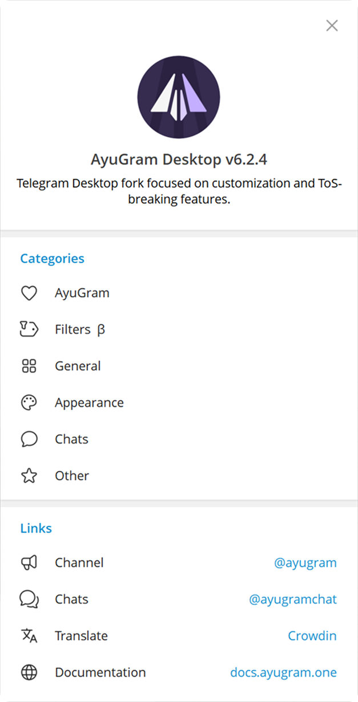
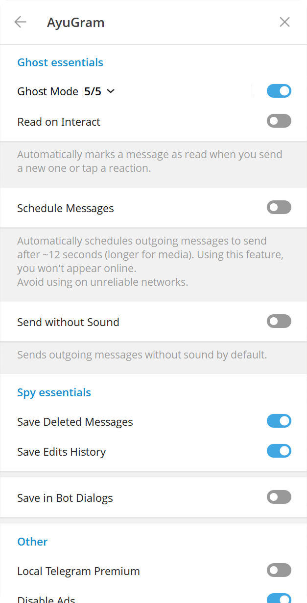
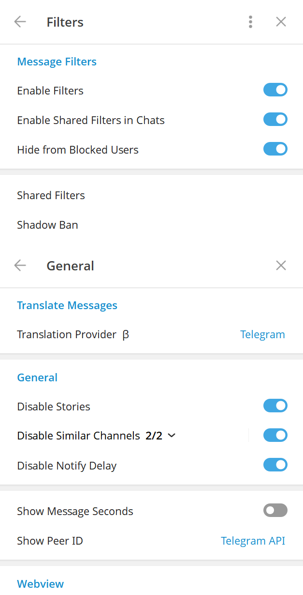
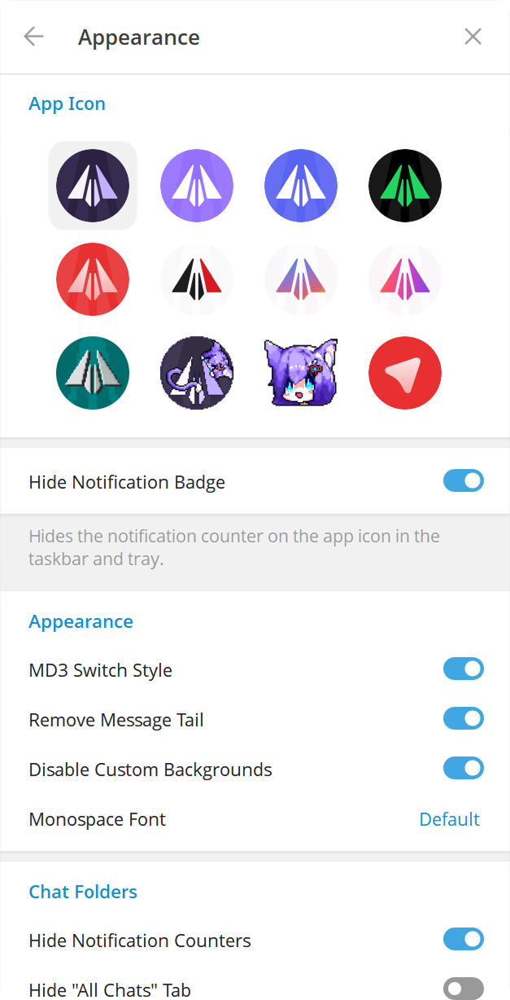
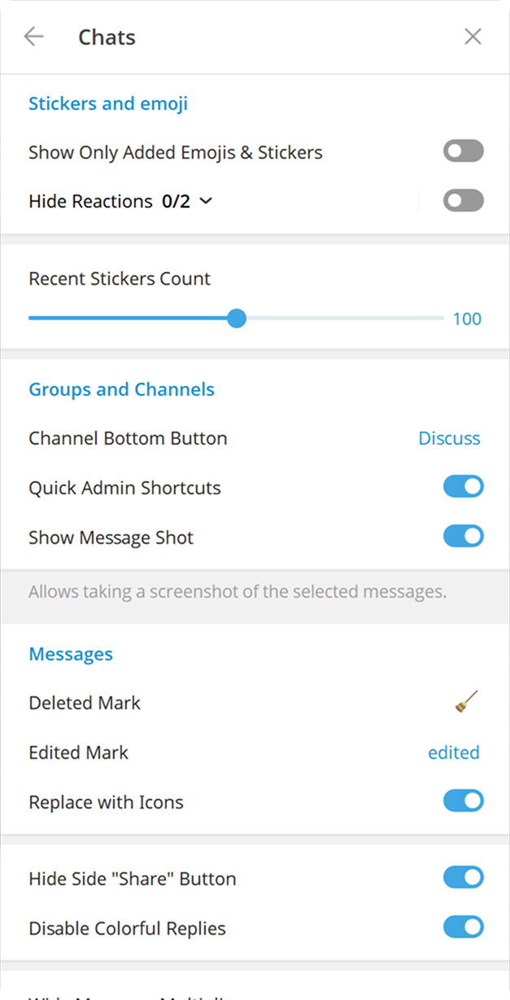

# TypendruckerGram

> [!WARNING]
> **Неофициальная сборка — возможны баги.**
>
> TypendruckerGram — неофициальный клиент Telegram на основе [AyuGram Community Edition](https://github.com/AyuGram/AyuGramDesktop) и **Telegram Desktop 7.0.3**. Он **не** делается командой AyuGram, Radolyn Labs или Telegram и никак с ними не связан. Используйте на свой страх и риск.

📦 **[Скачать последний релиз](../../releases/latest)** — Windows x64.

[ [English](README.md)  |   Русский ]

## Функции и Фишки

- Полный режим призрака (настраиваемый)
- История удалений и изменений сообщений
- Кастомизация шрифта
- Режим Стримера
- Локальный телеграм премиум
- Переводчик
- Превью медиа и быстрая реакция при сильном нажатии на тачпад (macOS)
- Улучшенный вид

И многое другое. Посмотрите [документацию AyuGram](https://docs.ayugram.one/desktop/) для более подробной информации.

<h3>
  

    
Превью

    <table>
      <tr>
        <td></td>
        <td></td>
        <td></td>
      </tr>
      <tr>
        <td></td>
        <td></td>
      </tr>
    </table>
  

</h3>

## Установка

Готовые сборки для Windows лежат во вкладке [Releases](../../releases).
Они собираются через GitHub Actions из этого репозитория. Автообновление отключено.

## Сборка

Следуйте [инструкции по сборке](docs/building-win-x64.md).

### Примечания для Windows

Убедитесь что у вас присутствуют эти зависимости:

- C++ MFC latest (x86 & x64)
- C++ ATL latest (x86 & x64)
- последний Windows 11 SDK

## Использованные материалы

### Телеграм клиенты

- [AyuGram](https://github.com/AyuGram/AyuGramDesktop) от Radolyn Labs
- [Telegram Desktop](https://github.com/telegramdesktop/tdesktop)
- [Kotatogram](https://github.com/kotatogram/kotatogram-desktop)
- [64Gram](https://github.com/TDesktop-x64/tdesktop)
- [Forkgram](https://github.com/forkgram/tdesktop)

### Использованные библиотеки

- [JSON for Modern C++](https://github.com/nlohmann/json)
- [SQLite](https://github.com/sqlite/sqlite)
- [sqlite_orm](https://github.com/fnc12/sqlite_orm)

### Иконки

- [Solar Icon Set](https://www.figma.com/community/file/1166831539721848736)

### Боты

- [TelegramDB](https://t.me/tgdatabase) для получения юзернейма по ID (до закрытия бесплатной версии 2 апреля 2026)
