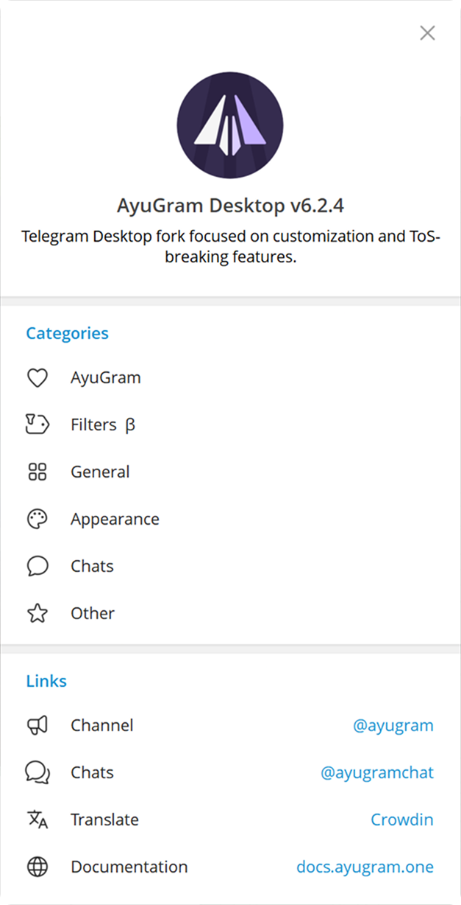
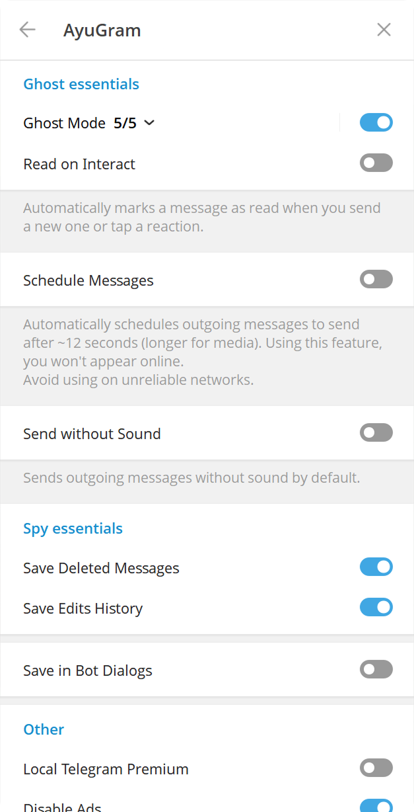
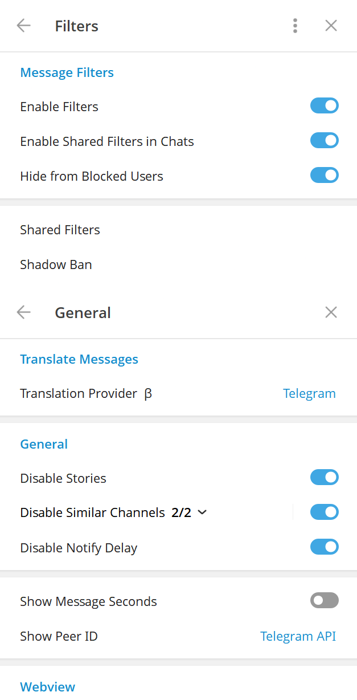
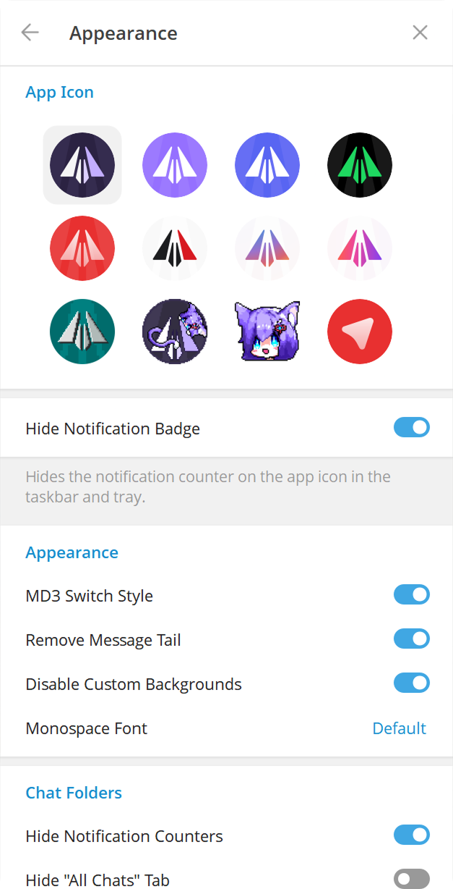
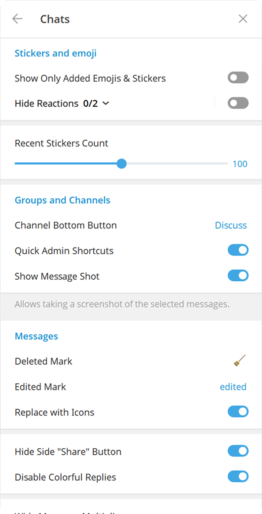

# TypendruckerGram

> [!WARNING]
> **Unofficial build — may contain bugs.**
>
> TypendruckerGram is an unofficial Telegram client based on the [AyuGram Community Edition](https://github.com/AyuGram/AyuGramDesktop) and **Telegram Desktop 7.0.3**. It is **not** made by the AyuGram team, Radolyn Labs, or Telegram, and is neither affiliated with nor endorsed by them. Use it at your own risk.

📦 **[Download the latest release](../../releases/latest)** — Windows x64.

[ English  |   [Русский](README-RU.md) ]

## Features

- Full ghost mode (flexible)
- Messages history
- Anti-recall
- Font customization
- Streamer mode
- Local Telegram Premium
- Translator
- Media preview & quick reaction on force click (macOS)
- Enhanced appearance

And many more. Check out the [AyuGram documentation](https://docs.ayugram.one/desktop/).

<h3>
  

    
Preview

    <table>
      <tr>
        <td></td>
        <td></td>
        <td></td>
      </tr>
      <tr>
        <td></td>
        <td></td>
      </tr>
    </table>
  

</h3>

## Downloads

Prebuilt Windows binaries are published in the [Releases](../../releases) tab.
They are built by GitHub Actions from this repository. Automatic updates are disabled.

## Building

Follow the [build guide](docs/building-win-x64.md).

### Remarks for Windows

Make sure you have these components installed with VS Build Tools:

- C++ MFC latest (x86 & x64)
- C++ ATL latest (x86 & x64)
- latest Windows 11 SDK

## Credits

### Telegram clients

- [AyuGram](https://github.com/AyuGram/AyuGramDesktop) by Radolyn Labs
- [Telegram Desktop](https://github.com/telegramdesktop/tdesktop)
- [Kotatogram](https://github.com/kotatogram/kotatogram-desktop)
- [64Gram](https://github.com/TDesktop-x64/tdesktop)
- [Forkgram](https://github.com/forkgram/tdesktop)

### Libraries used

- [JSON for Modern C++](https://github.com/nlohmann/json)
- [SQLite](https://github.com/sqlite/sqlite)
- [sqlite_orm](https://github.com/fnc12/sqlite_orm)
- [androidx sources](https://github.com/androidx/androidx)

### Icons

- [Solar Icon Set](https://www.figma.com/community/file/1166831539721848736)

### Bots

- [TelegramDB](https://t.me/tgdatabase) for username lookup by ID (until closing free inline mode at 2 April 2026)
